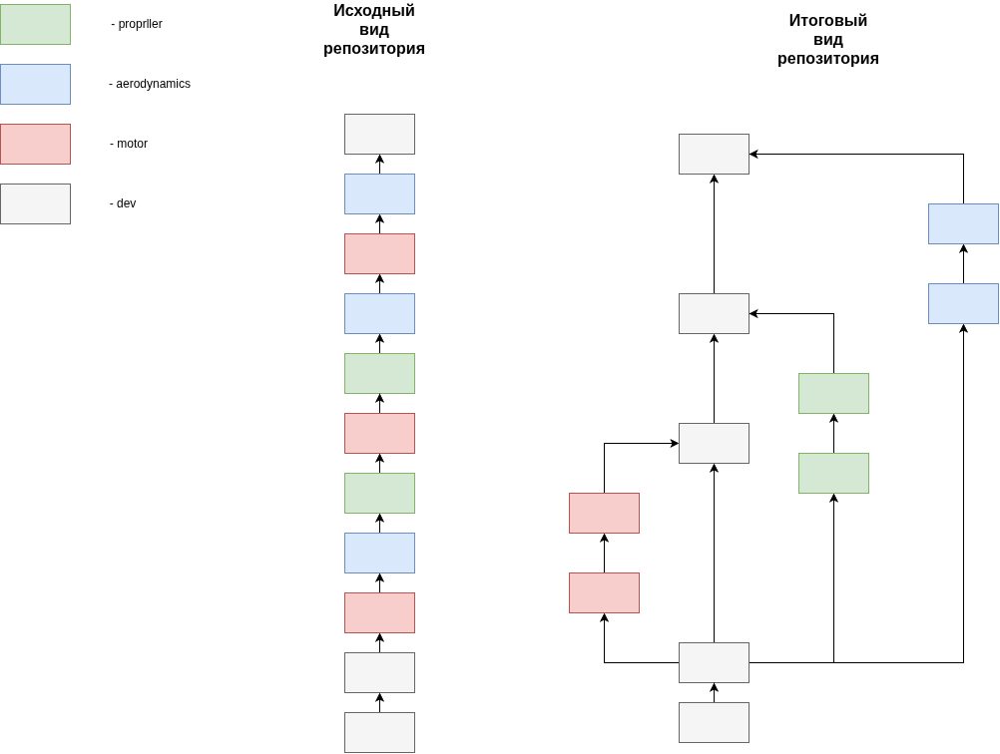

##### FlightDynamic
Репозиторий с основными файлами для модели динамики

#### Задание1

Необходимо привести в порядок историю изменений в репозитории.

Для этого создайте три ветки: motor, aerodynamics и propeller. В репозитории находятся три файла с соответствующими названиями.

Распределите коммиты по веткам таким образом, чтобы в каждой ветке находились только те коммиты, которые связаны с изменением соответствующего файла. Например, все коммиты, затрагивающие файл motor, должны находиться в ветке motor.

Необходимые команды:

```
git checkout -b <название ветки>
git rebase -i <sha>
git cherry-pick <sha1><sha2>
git add .
git commit -m "<message>"
```


>>>>>>> 8f03db5 (README)
